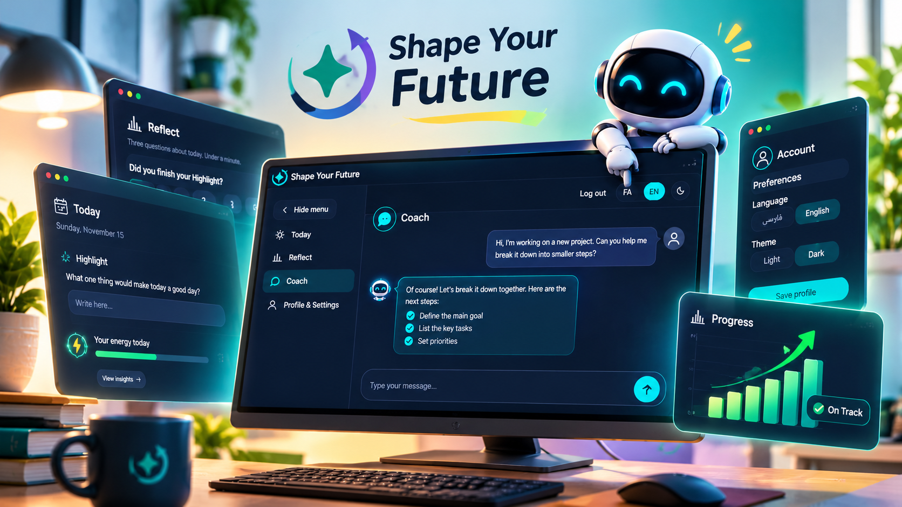
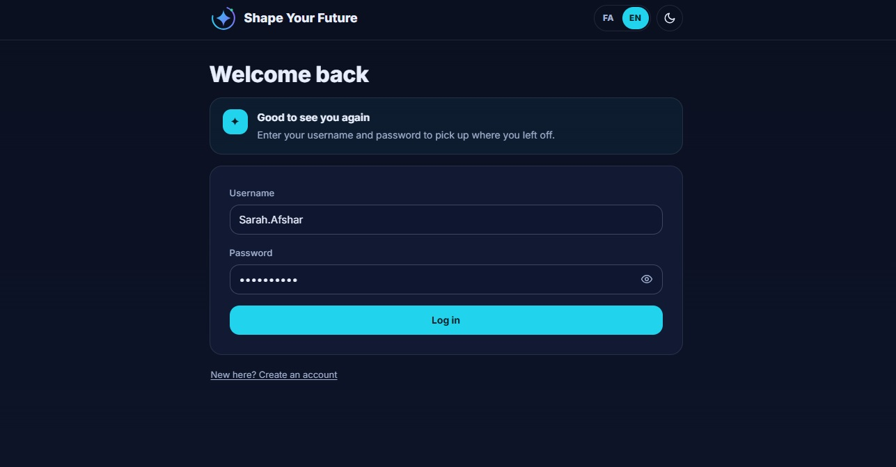
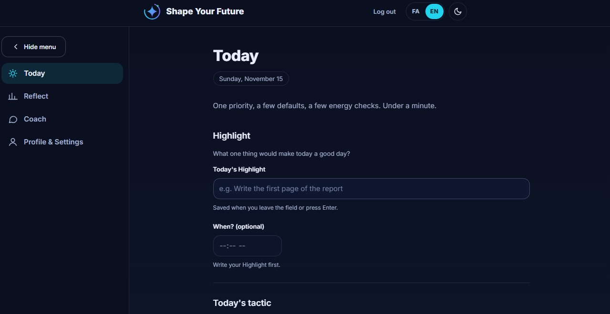
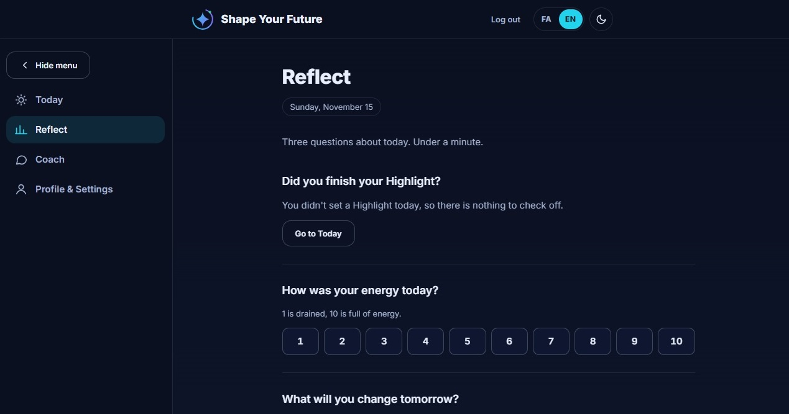
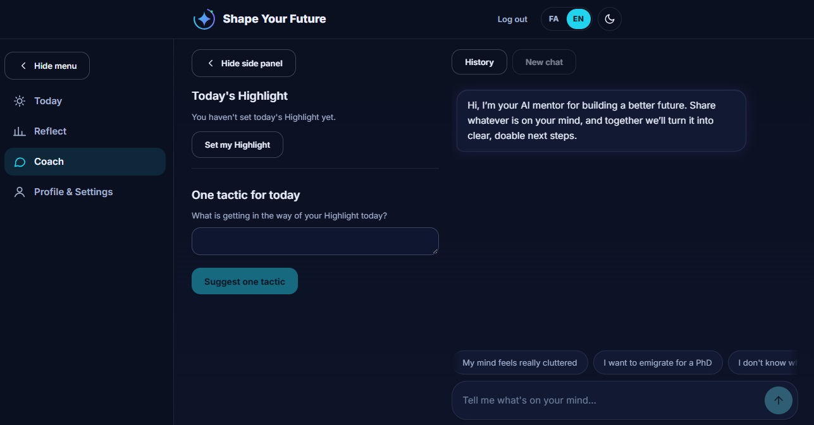
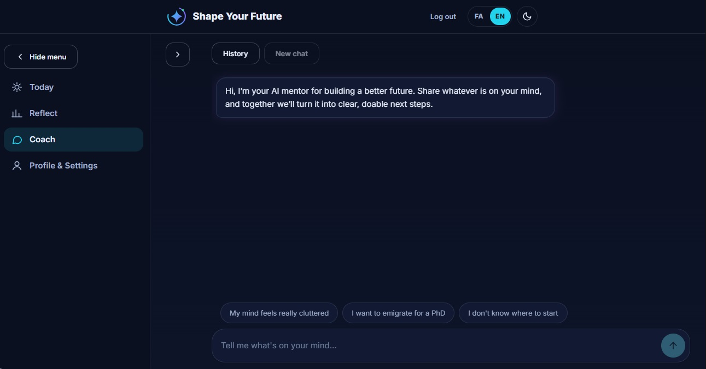
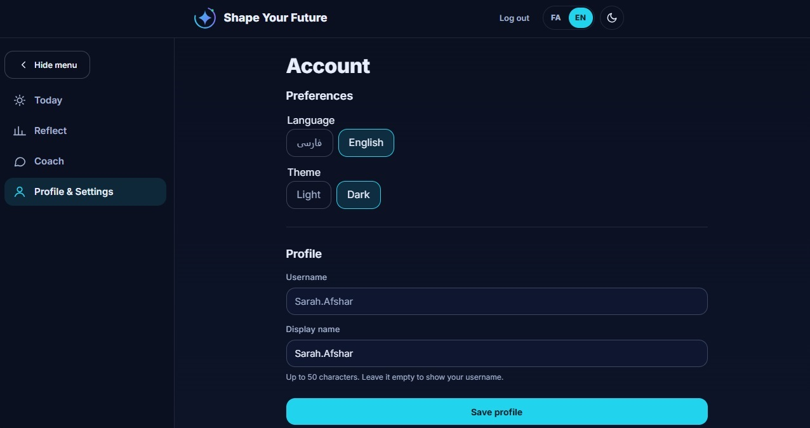
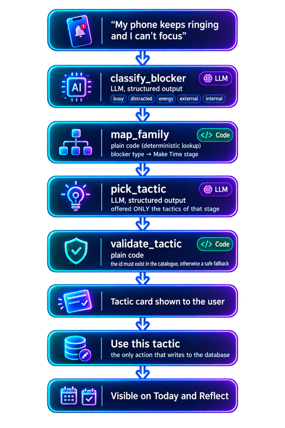
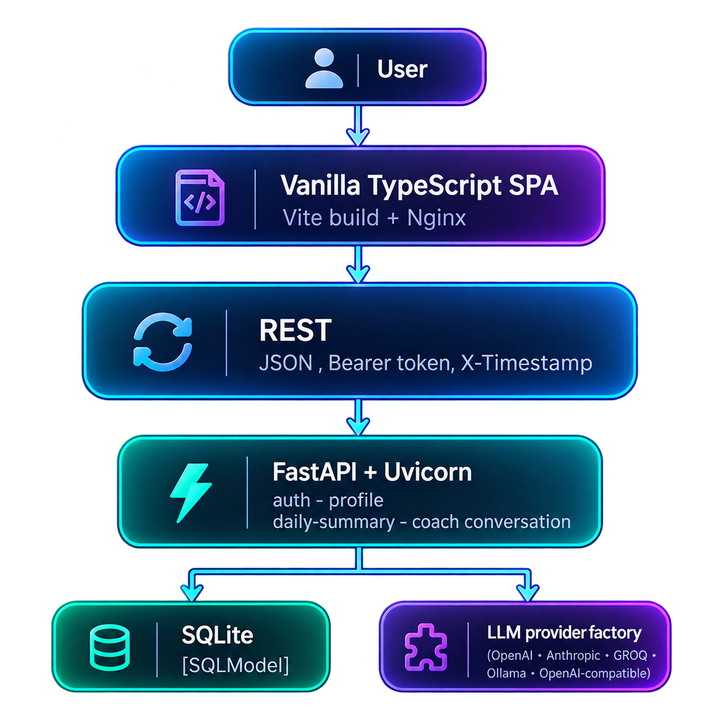

<<<<<<< HEAD
<div align="center">


# Shape Your Future

**آینده‌ات را بساز**

### A gentle AI coach for the days when things aren't going well




</div>

---

## Overview

**Shape Your Future** is a web app inspired by, and built on, the ideas and techniques of the book *Make Time: How to Focus on What Matters Every Day* by Jake Knapp and John Zeratsky (published in Persian as «خلق زمان»).

The product stresses **simplicity** while staying genuinely **useful**. There are no points, no streaks and no crowded dashboards. Each day is one small loop:

**Highlight** (one priority for the day) → **Laser** (cut distractions) → **Energize** (four simple checks) → **Reflect** (evening review)

### When is this app for?

Open it whenever you feel your work isn't going well, your mind is scattered, your energy is low, or you simply need to talk something through. The app shows you the **first practical step** out of that state: not ten pieces of advice, just **one tactic** that fits today's obstacle.

> The design rule behind the whole project: **the AI can propose, but only you can save.**
> A suggested tactic is written to your day only after you press *Use this tactic*.

### Bilingual: English and Persian

The app is **bilingual** and fully supports **Persian (Farsi)** alongside English: every screen is translated, the layout switches to **right-to-left (RTL)**, the Persian font (Vazirmatn) is bundled, and the AI coach replies in your language. Switch at any time with the **FA / EN** toggle in the top bar or in *Profile & Settings*. Light and dark themes are included too.

---

## Key Features

- **Daily loop** on a single Today screen: Highlight, three Laser cuts, four Energize checks, an optional scheduled time and a focus timer
- **Evening Reflect:** energy (1–10), a free note, what to change tomorrow, and whether you applied today's tactic
- **LLM-powered tactic card:** describe today's obstacle, the AI classifies it and suggests **one** tactic from a fixed catalogue of **87 tactics**
- **AI Coach chat** with saved conversation history. The coach can read today's Highlight but cannot change anything in your day
- **Human in the loop:** nothing the AI suggests is saved without your explicit confirmation
- **English / Persian** UI, RTL/LTR layout, light / dark themes
- **Time-zone-aware days:** your "today" is your calendar day, not the server's
- Token-based auth, rate limiting with `Retry-After`, security headers, request IDs
- **Provider-neutral LLM layer:** OpenAI, Anthropic, Groq, Ollama, or any OpenAI-compatible API
- One-command local setup with Docker Compose

---

## App Tour

**Login:** sign in with a username and password to pick up where you left off.

<div align="center">



</div>

<br>

**Today:** set one Highlight (with an optional time), then cut distractions and run four quick energy checks, all in under a minute.

<div align="center">



</div>

<br>

**Reflect:** three short evening questions: did you finish your Highlight, how was your energy, and what will you change tomorrow.

<div align="center">



</div>

<br>

**Coach, tactic card:** describe what is getting in the way and get exactly one suggested tactic, saved only if you confirm it.

<div align="center">



</div>

<br>

**Coach, chat:** a short, friendly conversation with the AI mentor, with starter prompts and saved history.

<div align="center">



</div>

<br>

**Profile & Settings:** choose Persian or English, light or dark theme, and manage your display name and account.

<div align="center">



</div>

---

## How the AI Tactic Works

The model is never allowed to invent advice. Each step is either a small, constrained LLM call or plain code:

<div align="center">



</div>

Why this shape:

- **Grounded:** the model can only choose from the 87-tactic catalogue (`backend/app/llm/tactics.py`).
- **Predictable:** the blocker → stage mapping is a lookup table, not a prompt.
- **Safe:** `POST /coach/tactic/suggest` changes no row in any table (covered by tests); only `POST /coach/tactic/confirm` saves.
- **Cheap:** two short structured calls with a low-cost model.

The Coach chat is separate: it keeps its own conversation history, can read today's Highlight so answers fit your real day, has no tools, and never writes to your daily loop.

---

## Architecture

<div align="center">



</div>

| Service | Technology | Default port (Docker) | Responsibility |
|---|---|---:|---|
| **Frontend** | Nginx serving the static Vite build | `13010` | Delivers the single-page app |
| **Backend** | Uvicorn running FastAPI | `18010` | REST API, daily loop, LLM calls |
| **Database** | SQLite in the Docker volume `backend_data` | – | Users, daily entries, chat history |

Ports are configurable through `.env`.

---

## Technical Details

### Languages and technologies

| Area | Stack |
|---|---|
| **Backend** | Python 3.12, FastAPI, Uvicorn, SQLModel, SQLite, Pydantic v2, slowapi, LangChain / LangGraph (`langchain-openai`, `-anthropic`, `-groq`, `-ollama`), pytest, httpx |
| **Frontend** | TypeScript, Vite, vanilla DOM (**no framework**), Vitest + jsdom, Inter and Vazirmatn fonts |
| **Infrastructure** | Docker, Docker Compose, Nginx |

### Engineering highlights

- **Approval rule enforced by tests:** `test_coach_approval_rule.py` checks that suggesting a tactic changes no table, and that only an explicit confirm writes.
- **One place decides "today":** `app/api/day.py` is the only module that turns the clock into a calendar day (`?day=` or the `X-Timezone` header). A guard test fails if another module reads the clock for a day, so a tactic confirmed in Tehran at 00:30 lands on the right day.
- **Rate limiting done properly:** per-route limits with a custom 429 handler that always returns a valid `Retry-After`.
- **Secrets hygiene:** configuration comes from the environment only. With `APP_ENV=production` the backend refuses to start without a strong random `SECRET_KEY`. A test fails if a key-shaped string appears anywhere in the repository.
- **Observability:** JSON logging, per-request `X-Request-ID`, no stack traces leaked to clients.
- **Security headers and strict CORS:** explicit origin allow-list, `nosniff`, `X-Frame-Options: DENY`, HSTS in production.
- **i18n parity check:** `npm run check:i18n` fails if an English key or placeholder is missing in Persian (or the other way round).
- **Tests need no API key:** the backend suite stubs the model and uses a temporary database.

---

## Getting Started on Windows

### Prerequisites

1. [**Git for Windows**](https://git-scm.com/download/win)
2. [**Docker Desktop**](https://www.docker.com/products/docker-desktop/) with the WSL 2 backend (the default). After installing, open Docker Desktop and wait until it shows *Running*.
3. An **LLM API key** (optional). Without one the app still starts, but the AI features answer with an "AI assistant is not available" message.

### Step 1: Get the project

Open PowerShell:

```powershell
git clone <repository-url>
cd <repository-folder>
```

### Step 2: Create your settings file

```powershell
Copy-Item .env.example .env
notepad .env
```

Fill in at least:

```ini
LLM_PROVIDER=openai_compatible
LLM_API_KEY=your-key
LLM_BASE_URL=your-openai-compatible-endpoint
LLM_MODEL_CHEAP=model-name
```

> To use OpenAI, Anthropic or Groq directly, set `LLM_PROVIDER` to `openai` / `anthropic` / `groq`, put the key in `OPENAI_API_KEY` / `ANTHROPIC_API_KEY` / `GROQ_API_KEY`, and uncomment the matching line in `docker-compose.yml`.
> `.env` is git-ignored. **Never commit it.**

### Step 3: Start the app

```powershell
docker compose up --build
```

The first build takes a few minutes. When it is ready:

| What | Address |
|---|---|
| **App** | http://localhost:13010 |
| API health | http://localhost:18010/healthz |
| API docs (development only) | http://localhost:18010/docs |

### Step 4: Create an account and log in

1. Open http://localhost:13010 in your browser.
2. On the login page, click **New here? Create an account**.
3. Choose a **username** and a **password** (at least 8 characters) and confirm it.
4. After registering you are signed in. Use the side menu to open **Today**, **Reflect**, **Coach** and **Profile & Settings**.
5. Switch language (FA / EN) and light/dark theme from the top bar.
6. Next time, log in with the same username and password.

### Handy commands

| Task | Command |
|---|---|
| Run in the background | `docker compose up -d --build` |
| Stop containers | `docker compose down` |
| Follow backend logs | `docker compose logs -f backend` |
| Rebuild after code changes | `docker compose up --build` |
| Delete all data and start fresh | `docker compose down -v` |

### Common Windows problems

- **"port is already allocated" or "forbidden by its access permissions":** Windows (Hyper-V / WinNAT) can reserve port ranges. Pick other ports in `.env`, for example:

  ```ini
  BACKEND_PORT=18011
  FRONTEND_PORT=13011
  VITE_API_BASE_URL=http://localhost:18011
  ```

  then run `docker compose up --build` again.
- **The app opens but cannot reach the API:** `VITE_API_BASE_URL` is baked into the frontend at build time. After changing a port, always run with `--build`.
- **"AI assistant is not available":** the LLM key or endpoint in `.env` is empty or wrong.
- **Docker will not start:** make sure Docker Desktop is running and virtualization is enabled in the BIOS.

---

## Running Without Docker (Development)

Requires **Python 3.12** and **Node.js 20**.

**Backend** → http://localhost:8000

```powershell
cd backend
python -m venv .venv
.venv\Scripts\Activate.ps1
pip install -r requirements.txt
Copy-Item ..\.env.example .env
uvicorn app.main:app --reload
```

**Frontend** → http://localhost:5173 (in a second PowerShell window)

```powershell
cd frontend
npm ci
npm run dev
```

> If PowerShell blocks the activation script: `Set-ExecutionPolicy -Scope Process -ExecutionPolicy RemoteSigned`

On macOS / Linux, activate the environment with `source .venv/bin/activate` and copy the file with `cp ../.env.example .env`.

---

## Configuration

All real values live only in `.env` (git-ignored). Main variables:

| Variable | Purpose |
|---|---|
| `LLM_PROVIDER` | `openai`, `anthropic`, `groq`, `ollama` or `openai_compatible` (default) |
| `LLM_API_KEY` | Key for `openai_compatible` providers (no default on purpose) |
| `LLM_BASE_URL` / `LLM_MODEL_CHEAP` | Endpoint and model for `openai_compatible` |
| `OPENAI_API_KEY` / `ANTHROPIC_API_KEY` / `GROQ_API_KEY` | Keys for the native providers |
| `APP_ENV` | `development` (default) or `production` |
| `SECRET_KEY` | Signs login tokens. Required and strong in production |
| `BACKEND_PORT` / `FRONTEND_PORT` / `VITE_API_BASE_URL` | Host ports and API address |
| `RATE_LIMIT_PER_MINUTE` | Limit for the LLM routes |

Generate a production secret:

```bash
python -c "import secrets; print(secrets.token_urlsafe(48))"
```

---

## Testing

```bash
# Backend: no API key or network needed, the model is stubbed
cd backend
python -m pytest -q

# Frontend
cd frontend
npx tsc --noEmit        # type check
npm run build           # production build
npm run check:i18n      # English / Persian key parity
npx vitest run          # smoke tests
```

Or run everything with one script: `bash scripts/verify-all.sh`.

A manual browser checklist is in [`docs/growth-os/09-smoke-test.md`](docs/growth-os/09-smoke-test.md).

---

## API Overview

| Method | Endpoint | Description |
|---|---|---|
| `POST` | `/auth/register` · `/auth/login` | Create an account, get a token |
| `GET` `PUT` | `/daily-entry/today` | Read or save today's loop |
| `GET` | `/daily-entry/recent` | Recent days |
| `POST` | `/coach/tactic/suggest` | AI proposes one tactic (saves nothing) |
| `POST` | `/coach/tactic/confirm` | User approves, tactic is saved to today |
| `GET` | `/coach/tactic/today` | Today's confirmed tactic |
| `POST` | `/conversation/start` · `/conversation/continue` | Coach chat |
| `GET` | `/conversation` · `/conversation/{id}` | Chat history and transcript |
| `GET` `PUT` | `/profile/me` · `/profile/me/password` | Profile and password |

Interactive docs are served at `/docs` in development.

---

## Project Structure

```text
├── backend/
│   ├── app/
│   │   ├── api/routes/     # auth, profile, daily_entry, coach, conversation
│   │   ├── api/day.py      # the single "user's calendar day" helper
│   │   ├── services/       # coach_tactics, chat_service
│   │   ├── llm/            # provider factory, tactic catalogue, blocker map
│   │   ├── core/           # config, security, rate limit, logging, request id
│   │   ├── db/             # SQLModel models and database setup
│   │   └── main.py         # FastAPI application entry point
│   ├── tests/
│   └── Dockerfile
├── frontend/
│   ├── src/
│   │   ├── views/          # today, reflect, coach, profile, auth
│   │   ├── state/          # per-screen state
│   │   ├── api/            # typed API client
│   │   └── lib/            # UI helpers and i18n (en / fa)
│   ├── smoke/              # Vitest smoke tests
│   ├── nginx.conf
│   └── Dockerfile
├── docs/                   # architecture, QA report, smoke-test checklist, images
├── scripts/                # verify-all.sh and helpers
├── docker-compose.yml
└── .env.example
```

---

## Limitations and Next Steps

- SQLite and a single backend container are designed for local use and small deployments, not horizontal scaling.
- The AI features were tested with a stubbed model; quality with different real models and providers is worth comparing.
- A real-browser end-to-end test suite (for example Playwright) has not been added yet.
- Possible next steps: reminders for the evening Reflect, weekly summaries written by the user, export of daily entries.

---

## Acknowledgements

The daily framework and the tactic catalogue are inspired by *Make Time: How to Focus on What Matters Every Day* by Jake Knapp and John Zeratsky. This project is an independent work and is not affiliated with or endorsed by the authors.

---


## 👤 About the Author

**Sarah M Afshar**  

Python Developer specializing in Generative AI  

Focused on **Large Language Models (LLMs)**, neural network fundamentals, and intelligent system development.

🔗 GitHub: https://github.com/afshars  
🔗 LinkedIn: https://www.linkedin.com/in/sara-m-afshar/

---

## License

Released under the MIT License. See [`LICENSE`](LICENSE).
=======
# LLM-Projects
Collection of LLM projects, covering fine-tuning, vision models, and other experiments.
>>>>>>> e3fdad61e2c348e68ae5d1ec3702304c0e613d77
